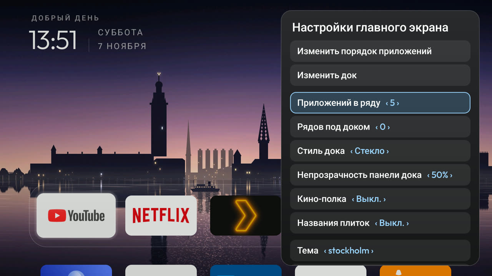

# Glass Settings Drawer

This fork replaces the opaque full-screen settings page in `launcher/` with a translucent right-side frosted-glass drawer (`LauncherSettingsActivity`).

## What it changes

- **Live Home preview:** The settings screen uses a translucent window and a `388dp` frosted-glass panel on the right edge. When you change a value, `MainActivity` updates behind the drawer immediately.
- **Single-row `‹ value ›` steppers:** Use **Up** and **Down** on the remote to select a row. Use **Left** and **Right** (or **OK**) to step through values.
- **Unified actions and controls:** Adds on-TV controls for **Edit dock**, **Dock style** (`Solid`, `Glass`, `Floating`), **Cinematic shelf**, **Always show names**, **Theme** (switches between folders in `files/themes/`), **Wallpaper** live-stepping, **Wallpaper dim** (`0%` to `70%`), **Wallpaper rotation** (`Off`, `15`, `30`, `60` min), **Focus style** (`Glass`, `Rim`, `Halo`), **App glow** (`Off`, `Dock`, `All`), **Idle clock** (`Off`, `5`, `10`, `15`, `30` min), **Back opens clock**, and **System stats**.
- **Permissions and size:** No `INTERNET` permission, no new permissions, and no background services. Release APK size stays under the 576 KB gate.

## Tested on

- Google TV Streamer (4K), Android TV 14 (`UTTK.250729.004`)
